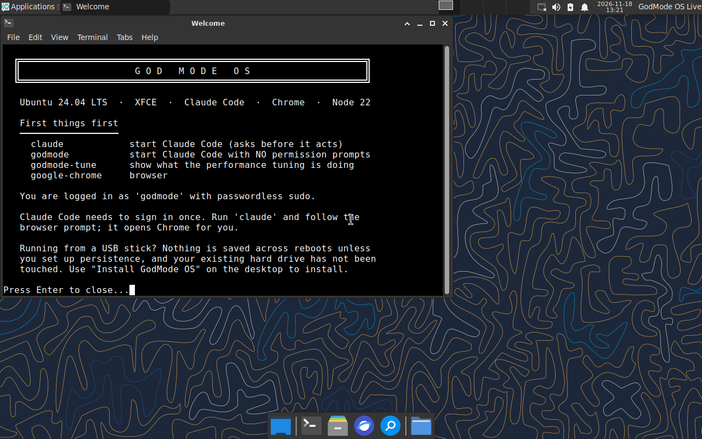
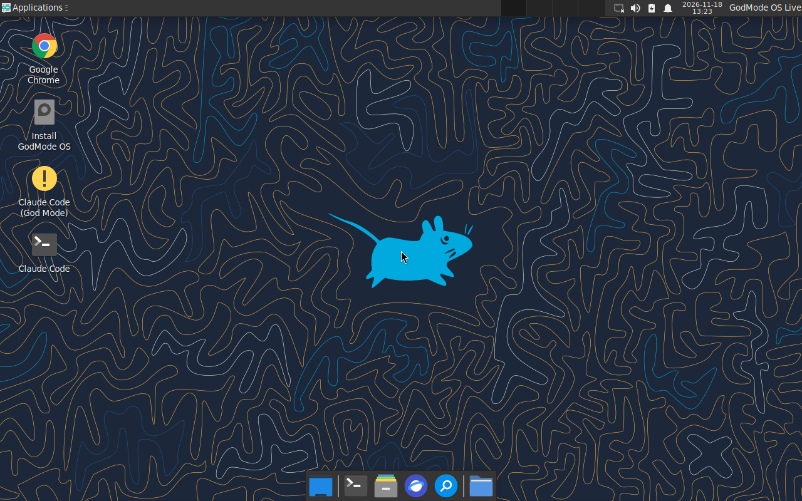
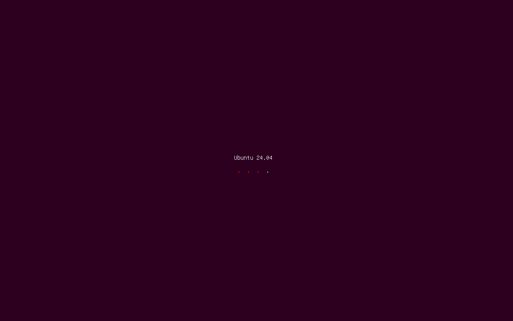

# Verification

What has actually been tested, and how to reproduce it. Anything not listed
here has not been verified — see "Not verified" at the bottom.

## Reproducing

```bash
sudo ./os/build.sh                            # build the ISO
./os/test/verify-image.sh os/out/*.iso        # offline checks, no boot, no root
./os/test/boot-test.py os/out/*.iso --mode uefi-secureboot --out /tmp/bt
./os/test/boot-test.py os/out/*.iso --mode bios            --out /tmp/bt
```

`verify-image.sh` loop-mounts the ISO and its squashfs and asserts on
structure, boot records, installed binaries, tuning files, enabled services,
and the absence of build-host leftovers. `boot-test.py` boots the image under
QEMU (OVMF for UEFI, SeaBIOS for legacy) and screenshots the console at
intervals; it needs no KVM and no display.

## Results

### Offline image checks — 65/65 passed

Run against the shipping image, built from this tree by `os/build.sh`:

```
godmode-os-0.1-amd64.iso   2.1 GB
sha256  332c716ef01e6d16648612d5071560177a7096f22a1a31a8f583f1fd4f395d06
```


```
./os/test/verify-image.sh os/out/godmode-os-0.1-amd64.iso \
                          os/work/filesystem.squashfs
  ...
  passed: 65   failed: 0   notes: 0
```

What that covers:

| Area | Checked |
|---|---|
| ISO structure | kernel, initrd, squashfs, manifests, boot menu, BIOS and UEFI boot images, medium id, md5sums |
| Boot menu | live / persistence / safe-graphics / integrity-check entries, all using `boot=casper` |
| Boot records | two El Torito entries (BIOS + UEFI); MBR boot code present, first byte `0xeb` |
| Secure Boot | signed shim + GRUB chain present, `BOOTX64.EFI` carries Microsoft's UEFI CA, signed-GRUB stub chains into the ISO menu |
| Payload | Claude Code 2.1.327 (launcher symlink + 372 MB native binary), Node v22.23.5, Google Chrome, XFCE, LightDM, Calamares |
| Tuning | `vm.swappiness=180`, zram on zstd, unquoted earlyoom args, I/O scheduler rules, `mitigations=off` hint present but commented |
| Access model | passwordless sudo rule, LightDM autologin as `godmode`, casper live user |
| Enabled units | zramswap, earlyoom, tlp, irqbalance, NetworkManager, fstrim, lightdm via display-manager |
| Masked units | NetworkManager-wait-online, apport, whoopsie |
| Absent by design | snapd (and pinned to priority -10), build-host proxy config, build-host CA certificate, `policy-rc.d`, diverted `initctl` |

Image facts: kernel 6.8.0-149-generic, 1164 packages, 2.0 GB squashfs.

### QEMU boot test — booted to desktop with Secure Boot **enforcing**

The important question for a retail laptop is not "does it boot" but "does it
boot without the owner having to disable Secure Boot". So the test runs the
Secure Boot enforcing firmware with Microsoft's keys already enrolled — the
same trust configuration an HP 15 ships with:

```
qemu-system-x86_64 -machine q35,smm=on \
  -drive if=pflash,...,file=/usr/share/OVMF/OVMF_CODE_4M.secboot.fd \
  -drive if=pflash,...,file=OVMF_VARS_4M.ms.fd \
  -global driver=cfi.pflash01,property=secure,value=on
```

4 GB RAM, 4 vCPU, **TCG software emulation** (the build host has no `/dev/kvm`).

| t | State |
|---|---|
| 30s | black — OVMF still initialising |
| 90s | Ubuntu 24.04 boot splash — shim and signed GRUB accepted, kernel running |
| 200s | full XFCE desktop, autologged in as `godmode`, welcome screen drawn |
| 250s | <kbd>Enter</kbd> sent over QMP to dismiss the welcome window |
| 310s | desktop with all four shortcuts: Chrome, Install GodMode OS, Claude Code, Claude Code (God Mode) |





**These timings are software emulation on a host without `/dev/kvm`, and say
nothing about speed on real hardware** — a real HP 15 boots this in a small
fraction of that.

### Legacy BIOS

Tested separately, because the two firmware paths share nothing: UEFI boots
Ubuntu's signed GRUB, legacy BIOS boots a GRUB image this build assembles
itself.

| t | State |
|---|---|
| 20s | SeaBIOS handing off |
| 40s | menu taken, kernel booting — Ubuntu 24.04 splash |



The first attempt at this failed: GRUB started but dropped to a bare `grub>`
prompt, because `search` is only a dispatcher and the image lacked
`search_fs_file`, so the early config could not locate the boot medium. UEFI
hid the problem entirely, since Canonical's signed GRUB already carries a full
module set. Fixed by compiling the search backends into the BIOS image and
falling back to `(cd0)` if the search still finds nothing.

### The shipped binaries actually run

Presence on disk is not proof of execution, so each was run from the built root:

```
node     v22.23.5
claude   2.1.327 (Claude Code)
chrome   Google Chrome 158.0.8127.36
godmode  resolves to /opt/node/bin/claude
calamares configs parse inside the image
```

## Not verified

- **Install to disk (Calamares).** The configuration is valid and the module
  sequence is conventional, but a real installation onto real hardware is the
  one thing a VM cannot stand in for. Treat the first install as the test.
- **Real-world Wi-Fi.** Firmware coverage depends on the specific chip. Broadcom
  parts need an out-of-tree driver that cannot be redistributed.
- **Suspend/resume and battery behaviour**, which are hardware-specific.
- **The performance claims as measured on the target laptop.** The tuning is
  well-established and each change is justified in the README, but no
  before/after benchmark has been run on an actual HP 15.
